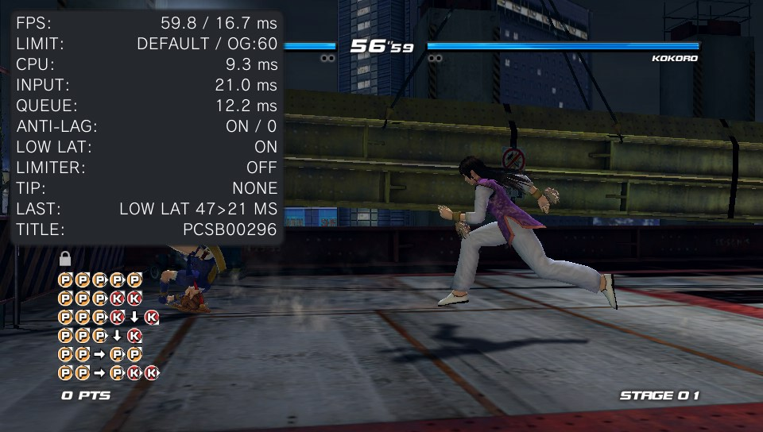
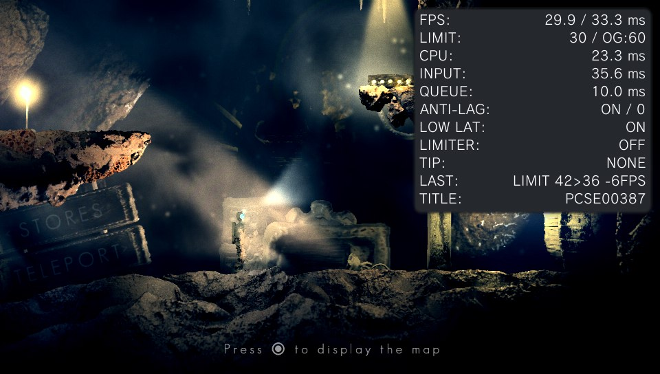
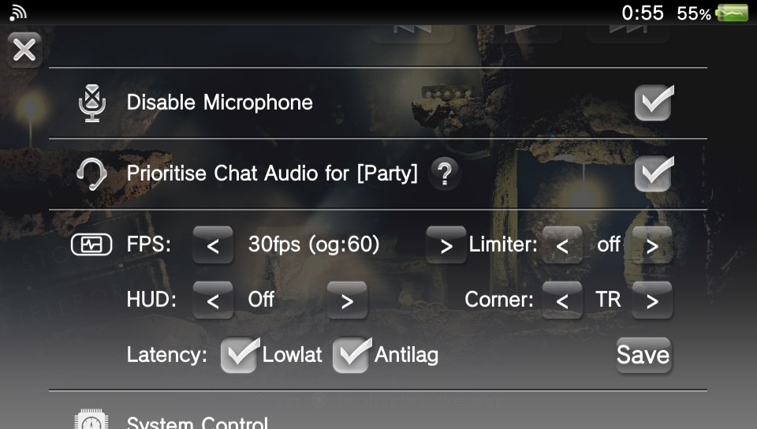
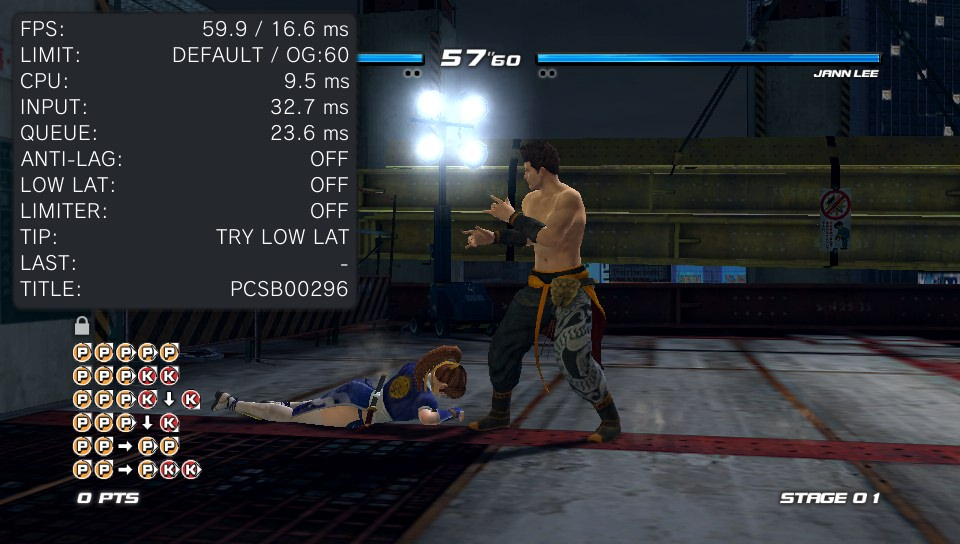
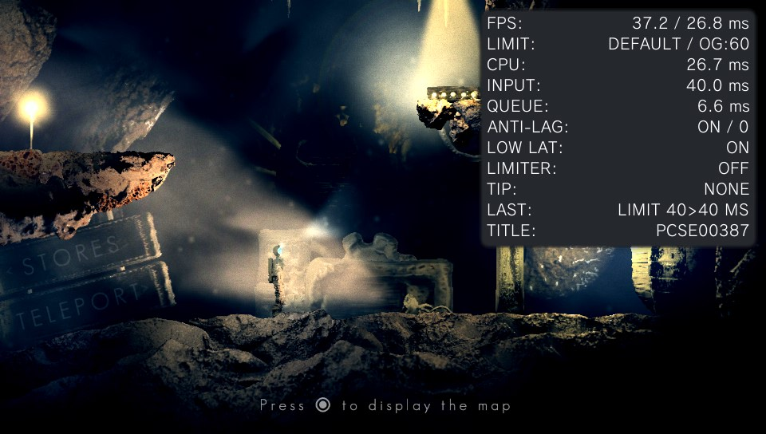

# fpsvita

fpsvita is a set of taiHEN plugins for the PS Vita that lowers input latency, shows what a
game's frames and input are doing, and sets frame-rate limits. You control it from the
quick menu while a game runs, and it keeps a profile per game.

| Overlay | Frame limit | Quick menu |
|---|---|---|
|  |  |  |

*Left: Dead or Alive 5 Plus with Lowlat and Antilag, INPUT 21 ms at 60 fps. Middle: The
Swapper held at a steady 30. Right: fpsvita's rows in the quick menu. Before and after
shots are [below](#before-and-after).*

## What it does

- **Antilag**: hands the game a newer controller sample so a button press reaches the screen
  sooner, without changing the game's frame rate. On by default; at a 30 or 20 limit it also
  moves the game's input read later.
- **Overlay**: frame rate, CPU time, input age (INPUT) and queue time over the game, plus a
  TIP row with advice (`tips=0` turns it off) and a LAST row with before/after numbers for
  your last change.
- **Lowlat, Limiter, Tearing**: a shorter display queue, a time-based limit for rates such as
  40 or 45, and immediate flips.
- **Frame limits**: 60, 30, 20 fps or uncapped, plus a Vsync wait for games that never wait.
- **Per-game profiles**: Save stores a game's settings, which load at its next launch.
- **Panel refresh (experimental)**: runs the screen at a lower rate such as 40 or 45 Hz for
  one game, so a game that cannot hold 60 gets evenly paced frames. Turn it on with
  `experimental=1`, then pick 50Hz, 45Hz or 40Hz on the FPS row. Tested on the OLED model; the
  Slim accepted 40 Hz in two reports.
- **Lite mode**: one plugin and two text files, without the quick menu or overlay.

Seven titles have measured before/after numbers in
[the latency measurements](docs/latency-measurements.md). How much other games gain is
unknown: the overlay's LAST row lets you measure your own.

## Before and after

| Lowlat and Antilag off | Lowlat and Antilag on |
|---|---|
|  |  |

*Dead or Alive 5 Plus at its own 60 fps, Full overlay. INPUT drops from 33 to 21 ms and the
frame rate stays at 60. Nearly all of it is Lowlat: at a game's own 60, Antilag only hands it
a fresher sample. The TIP row suggested Lowlat in the first shot.*

| Default | 30 limit |
|---|---|
|  |  |

*The Swapper keeps its own time, so a limit is safe. At Default it runs an uneven 37 fps; at
the 30 limit it holds a steady 30 and INPUT drops from 40 to 36 ms. LAST shows the trade:
6 ms less input lag for 6 fps fewer.*

## Before you change the frame rate

Many Vita games tie their speed to the frame rate. Above their own rate they run too fast,
below it they run in slow motion. Nothing outside the game can fix that. `Default` leaves the
game's pacing alone and is always safe. Check the
[compatibility list](docs/compatibility-list.md) before you pick a limit, and see
[why some games break](docs/GUIDE.md#why-some-games-break-at-another-frame-rate).

## Install

### Requirements

- A Vita on HENkaku or enso, so taiHEN loads plugins.
- A way to copy files: VitaShell's FTP server or USB.
- Optional: kubridge v0.3 or later, so a shell crash is logged.

fpsvita is tested on one retail OLED Vita (PCH-1000) with enso on firmware 3.65. Firmware
3.60 is expected to work but is untested. Reports from other models and firmware are
especially welcome.

### Steps

1. Download `fpsvita-vX.Y.Z.zip` from
   [the releases page](https://github.com/esp1esp1/fpsvita/releases) and unpack it.
2. Copy the files from its `ur0` folder to the same paths on the Vita:

   | File | Path on the Vita |
   |---|---|
   | Kernel module | `ur0:tai/fpsvita-kernel.skprx` |
   | Quick menu and overlay | `ur0:tai/fpsvita-ui.suprx` |
   | Per-game helper | `ur0:tai/fpsvita-helper.suprx` |
   | Menu resources | `ur0:data/fpsvita/fpsvita_plugin.rco` |

3. Find the taiHEN config in use. If `ux0:tai/config.txt` exists, taiHEN reads it and
   ignores `ur0:tai/config.txt`, so edit that one. In VitaShell, select the file and press
   Triangle, then Open with Text Editor.
4. Add each line under its section header. Create a header if it is missing:

   ```
   *KERNEL
   ur0:tai/fpsvita-kernel.skprx
   *main
   ur0:tai/fpsvita-ui.suprx
   *ALL
   ur0:tai/fpsvita-helper.suprx
   ```

   With PSVshellPlus installed, put the `fpsvita-ui` line above `PSVshellPlus_Shell.suprx`
   in `*main` to show fpsvita's rows above PSVshellPlus's. Below it puts them below.
5. Save the file and reboot the Vita.

### Check that it worked

Hold the PS button to open the quick menu. You should see three new rows starting with
`FPS:`, `HUD:` and `Latency:`. fpsvita also creates `ur0:data/fpsvita/config.txt` on its
first boot.

If the rows are missing, check that the `.rco` file is at its exact path and that the
kernel line sits under `*KERNEL`. Without either, the quick-menu plugin quits without
showing anything. `ur0:data/fpsvita/boot.log` says which one it found missing.

### Update

Replace all four files together and reboot. Never mix files from two versions: the modules
share one block of state, and a mismatch can crash. Your settings in `ur0:data/fpsvita/`
are kept.

### Uninstall

1. Remove the three fpsvita lines from the taiHEN config.
2. Delete the three `.skprx`/`.suprx` files from `ur0:tai/`.
3. Delete the `ur0:data/fpsvita/` folder (menu resources, settings and logs), unless you
   want your settings back after a reinstall; then delete only the `.rco` file.
4. Reboot.

## First use

1. Start a game.
2. Hold the PS button. On the `HUD:` row, press `>` until it reads `Full`. Close the menu.
3. Play for a few seconds. The `INPUT:` row shows how old your input is when a frame
   reaches the screen, for example `38.2 ms`.
4. Open the quick menu and untick `Antilag` (it starts ticked). Play on. After about 3
   seconds LAST reads something like `ANTI-LAG 31>38 MS`: INPUT before and after the change,
   in milliseconds.
5. Tick `Antilag` again. LAST shows the new before/after pair.
6. Press `Save` to keep this game's settings.

Next, read the [user guide](docs/GUIDE.md) for every option and what the overlay's rows
mean, and the [compatibility list](docs/compatibility-list.md) before trying a limit.

## Lite mode

`fpsvita-helper-lite.suprx`, in the zip's `lite` folder, is the helper without the kernel
module, quick menu or overlay. You set it up by editing two text files. Install it instead
of the full set, never next to it. See [Lite mode](docs/GUIDE.md#lite-mode).

## Conflicts and recovery

Do not run Framecapper with fpsvita: both hook the same display waits. Frame-rate patches
from other plugins, such as VitaGrafix FPS patches, work alongside it. The quick menu shows
the patched rate as the game's own (`og:`), and an fpsvita limit overrides it. Other
combinations are untested.

If the Vita's shell fails to start after installing:

1. Hold L while powering on. enso then skips plugins.
2. Open the taiHEN config in VitaShell and put `#` in front of the `fpsvita-ui` line.
3. Reboot, and report the problem with `ur0:data/fpsvita/boot.log` attached.

## Reporting a game and getting help

Open an issue at [github.com/esp1esp1/fpsvita/issues](https://github.com/esp1esp1/fpsvita/issues).
[Reporting a game](docs/GUIDE.md#reporting-a-game) lists what to include and how to collect
logs. Changes between versions are in [CHANGELOG.md](CHANGELOG.md).

## Credits and licence

fpsvita is licensed under GPL-3.0 (see [LICENSE](LICENSE)). Its display-wait hooks follow
Framecapper by Rinnegatamante, and its quick-menu hook and overlay style follow PSVshellPlus
by GrapheneCt. All credits and licences are in
[THIRD_PARTY_NOTICES.md](THIRD_PARTY_NOTICES.md).

> fpsvita was vibecoded with care. I'm not a developer, but I'm also not clueless. This software will be kept maintained in the future, and I'll respond to any issues.
